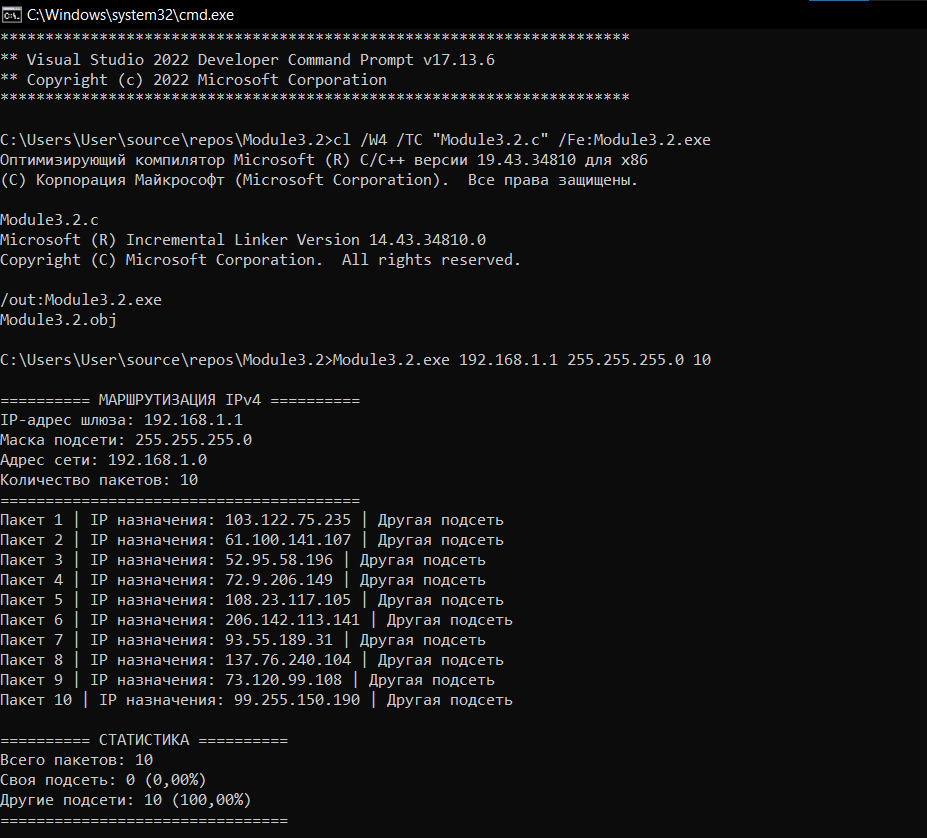
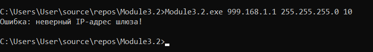
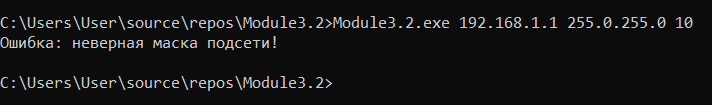
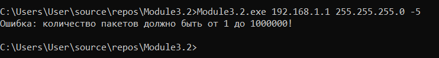

# Module 3.2 — Маршрутизация IPv4

Программа на языке C моделирует маршрутизацию IPv4-пакетов. Она определяет принадлежность случайно сгенерированных IP-адресов к подсети шлюза и выводит статистику.

### Ручная компиляция и запуск

Программа была собрана вручную через Developer Command Prompt в Visual Studio 2022, без использования кнопки Play.

Команда компиляции:

```cmd
cl /W4 /TC "Module3.2.c" /Fe:Module3.2.exe
```

Запуск с аргументами командной строки:

```cmd
Module3.2.exe 192.168.1.1 255.255.255.0 10
```

Аргументы:
- `192.168.1.1` — IP-адрес шлюза.
- `255.255.255.0` — маска подсети.
- `10` — количество пакетов.

Программа успешно обработала 10 пакетов и вывела итоговую статистику.



### Проверка обработки ошибок

**1. Некорректный IP-адрес**

```cmd
Module3.2.exe 999.168.1.1 255.255.255.0 10
```

Программа обнаружила недопустимый IP-адрес.



**2. Некорректная маска подсети**

```cmd
Module3.2.exe 192.168.1.1 255.0.255.0 10
```

Программа обнаружила неправильную маску подсети.



**3. Некорректное количество пакетов**

```cmd
Module3.2.exe 192.168.1.1 255.255.255.0 -5
```

Программа отклонила отрицательное количество пакетов.



### Результат

Программа успешно собрана и запущена вручную через командную строку. Проверена передача аргументов через `argc` и `argv`, а также обработка некорректных входных данных.
